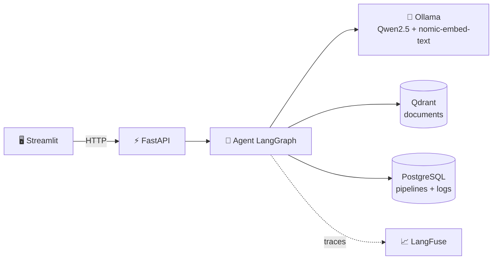
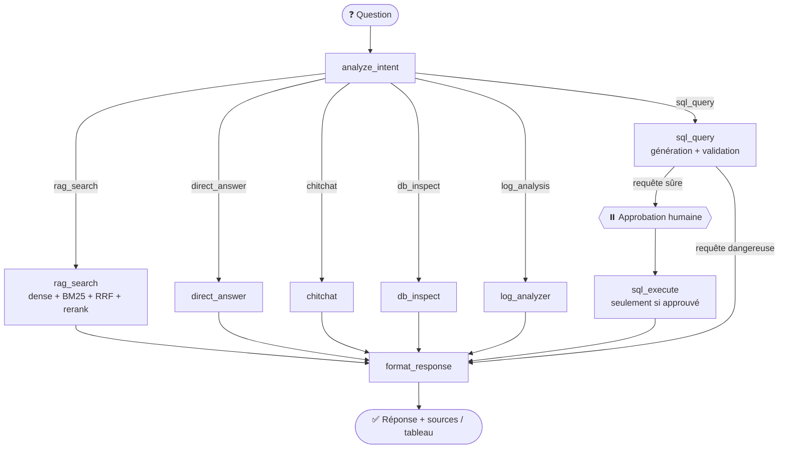

<div align="center">

# 🤖 Data Engineering Copilot

### Un assistant IA 100 % local qui cherche dans votre documentation, interroge votre base de données et analyse vos logs de pipelines.


**RAG hybride · Agent LangGraph · Text-to-SQL avec approbation humaine · Observabilité · Évaluation mesurée**

</div>

---

## ✨ En bref

Posez une question en langage naturel : l'agent **décide lui-même** quel outil utiliser.

| Vous demandez… | L'agent… |
|---|---|
| *« Why does Spark fail with OutOfMemoryError? »* | cherche dans vos documents (RAG hybride) et **cite ses sources** avec un score de pertinence |
| *« What tables are in the database? »* | inspecte le schéma PostgreSQL |
| *« Show me all failed pipelines »* | génère un `SELECT`, **vous demande l'approbation**, l'exécute et affiche un tableau |
| *« Now only the failed ones »* | comprend la question de suivi grâce à la mémoire de conversation |
| *« Why did the pipeline fail last night? »* | analyse les logs et synthétise les causes |

Tout tourne **en local** (Ollama + Qwen2.5) : aucune clé d'API payante, aucune donnée qui quitte votre machine.

## 📸 Aperçu

| Interface | Approbation SQL |
|:---:|:---:|
|  |  |
| **Recherche documentaire avec sources** | **Trace dans LangFuse** |
|  |  |

## 🧠 Fonctionnalités

- **Agent intelligent (LangGraph)** : un routeur classe chaque question en 6 intents (`rag_search`, `direct_answer`, `chitchat`, `db_inspect`, `sql_query`, `log_analysis`) et dirige vers le bon outil.
- **RAG hybride** : recherche dense (embeddings `nomic-embed-text`) + recherche lexicale BM25, fusionnées par **Reciprocal Rank Fusion**, puis reranking par **CrossEncoder**. Les réponses citent leurs sources.
- **Text-to-SQL sécurisé** : le LLM génère la requête, une validation stricte la filtre, puis un **humain approuve ou rejette** avant toute exécution (*Human in the Loop*).
- **Tableaux de résultats** : les résultats SQL s'affichent dans un vrai tableau interactif, sans résumé LLM qui pourrait déformer les valeurs.
- **Mémoire de conversation** : « *now only the failed ones* » fonctionne parce que l'historique récent est transmis au générateur SQL.
- **Analyse de logs** : détection des erreurs, des événements critiques et des motifs récurrents.
- **Observabilité (LangFuse)** : chaque question produit une trace avec un span par étape (entrées, sorties, durées).
- **Évaluation mesurée** : 3 métriques inspirées de RAGAS comparent 3 stratégies de retrieval sur un jeu de test.
- **Interface soignée** : thème sombre, badges d'intent, chemin des étapes, sources avec scores, boutons Approve / Reject.

## 🏗️ Architecture



### Le graphe de l'agent



Le graphe s'interrompt avant `sql_execute` (`interrupt_before`) et reprend après la décision de l'utilisateur, grâce au *checkpointer* de LangGraph.

## 🔒 Sécurité du SQL : défense en profondeur

Un LLM qui écrit du SQL est un risque. Plusieurs couches indépendantes s'empilent :

| Couche | Mécanisme |
|---|---|
| 1. Extraction | `extract_sql` isole la requête de la sortie du LLM et coupe au premier `;` (aucune seconde instruction) |
| 2. Validation | `validate_query` : `SELECT` uniquement, mots-clés interdits (`DROP`, `DELETE`, `UPDATE`, `INSERT`, `ALTER`…), pas de commentaires SQL, une seule instruction |
| 3. Approbation humaine | la requête est affichée, rien ne s'exécute sans clic sur **Approve** |
| 4. Exécution contrôlée | seconde validation avant exécution, enveloppe `LIMIT` (50 lignes max) |

## 📊 Résultats de l'évaluation

Dataset de 10 questions rédigées à partir des vrais documents ingérés. Les métriques : **Faithfulness** (hallucinations), **Answer Relevancy** (la réponse répond-elle à la question ?) et **Context Precision** (qualité du retriever, par similarité cosine avec la réponse de référence).

| Stratégie | Faithfulness | Relevancy | Precision | **Overall** |
|---|:---:|:---:|:---:|:---:|
| Dense (baseline) | 0.810 | 0.860 | 1.000 | 0.890 |
| **Hybride BM25 + RRF** | **0.860** | 0.860 | 1.000 | **0.907** |
| Hybride + Reranker | 0.750 | 0.780 | 1.000 | 0.843 |

**Ce que j'en conclus :** l'hybride BM25 + RRF est la meilleure stratégie sur ce dataset. Le reranker CrossEncoder aide sur les questions précises mais peut dégrader les questions multi-concepts (exemple observé : « Why are Airflow tasks stuck in queued state? »).

> ⚠️ **Limites assumées** : 10 questions seulement (forte variance), et un juge LLM de 3 milliards de paramètres, trop conservateur. En production, j'utiliserais un modèle plus grand comme juge et 50 questions ou plus. Les résultats se relancent avec `python -m eval.evaluate`.

## 🛠️ Stack technique

| Domaine | Technologies |
|---|---|
| LLM local | Ollama · Qwen2.5:3b · `nomic-embed-text` (embeddings 768 dimensions) |
| Orchestration | LangGraph (agent, état partagé, Human in the Loop) |
| Retrieval | Qdrant (dense) · BM25 · RRF · CrossEncoder |
| Données | PostgreSQL 16 |
| API | FastAPI · Pydantic · httpx (asynchrone) |
| Interface | Streamlit (CSS personnalisé) |
| Observabilité | LangFuse (SDK 2.36) |
| Infrastructure | Docker Compose |

## 🚀 Installation

### Prérequis

- Python 3.11 ou plus
- [Docker](https://www.docker.com/) et Docker Compose
- ~5 Go d'espace disque pour les modèles et ~8 Go de RAM

### 1. Cloner et installer

```bash
git clone https://github.com/7a99ui/data-engineering-copilot.git
cd data-engineering-copilot

python -m venv .venv
# Windows
.venv\Scripts\activate
# Linux / macOS
source .venv/bin/activate

pip install -r requirements.txt
```

### 2. Lancer les services (Ollama, Qdrant, PostgreSQL)

```bash
docker compose up -d
docker compose ps        # les 3 services doivent être « Up »
```

### 3. Télécharger les modèles (une seule fois)

```bash
docker exec copilot-ollama ollama pull qwen2.5:3b
docker exec copilot-ollama ollama pull nomic-embed-text
```

### 4. Configurer l'environnement

Créez un fichier `.env` à la racine. Toutes les variables et leurs valeurs par défaut sont décrites dans `app/config.py`.

```env
OLLAMA_BASE_URL=http://localhost:11434
LLM_MODEL=qwen2.5:3b

# Optionnel : observabilité LangFuse (vide = désactivé)
LANGFUSE_PUBLIC_KEY=
LANGFUSE_SECRET_KEY=
LANGFUSE_HOST=https://cloud.langfuse.com
```

### 5. Ingérer vos documents

```bash
python -u ingest.py --source ./docs
```

Formats pris en charge : PDF, Markdown, code (`.py`, `.sql`, `.js`, `.yaml`…). Chaque document est découpé en chunks (taille 1000, chevauchement 50), vectorisé et stocké dans Qdrant avec ses métadonnées (source, page, type).

### 6. Démarrer l'application

```bash
# Terminal 1 — l'API
uvicorn app.main:app --reload --host 0.0.0.0 --port 8000

# Terminal 2 — l'interface
streamlit run streamlit_app.py
```

Ouvrez **http://localhost:8501** 🎉. La documentation interactive de l'API est sur http://localhost:8000/docs.

## 💬 Essayez ces questions

```text
Why does Spark fail with OutOfMemoryError?        → recherche documentaire + sources
What tables are in the database?                  → inspection du schéma
how many tables are in the database?              → SQL + approbation
show me all pipelines                             → SQL + tableau
now only the failed ones                          → question de suivi (mémoire)
Why did the pipeline fail last night?             → analyse de logs
```

## 🔌 API

| Méthode | Route | Rôle |
|---|---|---|
| `GET` | `/health` | Vérifie que l'API tourne |
| `POST` | `/chat` | LLM seul, sans RAG |
| `POST` | `/ask` | RAG fixe (dense ou hybride), réponse avec sources |
| `POST` | `/agent` | Agent complet LangGraph avec outils et approbation SQL |

**Exemple : cycle d'approbation SQL**

```bash
# 1. Nouvelle question — l'agent propose une requête et se met en pause
curl -X POST http://localhost:8000/agent \
  -H "Content-Type: application/json" \
  -d '{"question": "show me all pipelines", "history": []}'
# → {"sql_query": "SELECT * FROM pipelines", "pending_approval": true, "thread_id": "abc-123", ...}

# 2. Décision humaine — l'agent reprend et exécute
curl -X POST http://localhost:8000/agent \
  -H "Content-Type: application/json" \
  -d '{"thread_id": "abc-123", "sql_approved": true}'
# → {"answer": "The query returned 3 rows...", "sql_result": {"columns": [...], "rows": [...]}, ...}
```

## 📈 Observabilité avec LangFuse

Chaque question produit une **trace** `agent_request` contenant un **span par nœud** du graphe : entrée, sortie, durée, et des métadonnées propres à chaque outil (score du meilleur chunk, requête SQL et résultat de la validation, durées base de données et LLM…).

LangFuse est **optionnel** : sans clés, il se désactive silencieusement et l'agent fonctionne normalement.

> ℹ️ Avec le SDK v2 utilisé ici, les données apparaissent dans l'interface LangFuse avec environ 15 minutes de retard.

## 🗂️ Structure du projet

```text
data-engineering-copilot/
├── app/
│   ├── main.py                 # API FastAPI (/health, /chat, /ask, /agent)
│   ├── config.py               # configuration centralisée (pydantic-settings)
│   ├── observability.py        # client LangFuse, new_trace / get_trace
│   ├── llm/client.py           # client Ollama (singleton, asynchrone)
│   ├── ingestion/              # parsers (PDF, Markdown, code), chunker, embedder, store
│   ├── rag/                    # retriever dense, hybride (BM25 + RRF), reranker, générateur
│   └── agent/
│       ├── router.py           # classification d'intent
│       ├── graph.py            # définition du graphe LangGraph
│       ├── nodes.py            # un nœud par outil
│       ├── state.py            # état partagé de l'agent
│       └── tools/              # db_inspector, sql_executor, sql_utils, log_analyzer
├── eval/                       # dataset, évaluation des 3 stratégies, comparaison
├── docs/                       # documents à ingérer
├── ingest.py                   # script d'ingestion en ligne de commande
├── streamlit_app.py            # interface utilisateur
├── docker-compose.yml          # Ollama, Qdrant, PostgreSQL
└── requirements.txt
```

## 🧭 Comment le projet a été construit

Le projet est développé par sprints, chacun documenté par un mode opératoire.

| Sprint | Livrable |
|:---:|---|
| 1 | Environnement Docker, LLM local, API FastAPI |
| 2 | Pipeline d'ingestion : parsing, chunking, embeddings, Qdrant |
| 3 | RAG de base avec sources citées et prompt anti-hallucination |
| 4 | RAG hybride : BM25, Reciprocal Rank Fusion, reranking CrossEncoder |
| 5 | Agent LangGraph avec routeur d'intent |
| 6 | Outils spécialisés : inspecteur de base, SQL avec approbation humaine, analyseur de logs |
| 7 | Évaluation scientifique du RAG (3 métriques, 3 stratégies) |
| 7a | Interface Streamlit professionnelle, fiabilisation du SQL, mémoire de conversation |
| 7b | Observabilité LangFuse |

## 🔭 Pistes d'amélioration

- [ ] Utilisateur PostgreSQL en lecture seule pour l'agent (sécurité renforcée côté base)
- [ ] Analyse de logs branchée sur la table `pipeline_logs` plutôt que sur des fichiers
- [ ] Amélioration du routeur sur les questions ambiguës
- [ ] Script de données d'exemple pour reproduire la démonstration en une commande
- [ ] Tests automatisés (extraction et validation SQL) avec intégration continue
- [ ] SDK LangFuse v3 pour des traces en temps réel
- [ ] Modèle plus grand pour la génération SQL et l'évaluation

## 🎯 Ce que ce projet démontre

Conception d'un **agent LLM** avec outils · **RAG hybride** et évaluation chiffrée · **sécurisation d'un Text-to-SQL** (validation, approbation humaine, défense en profondeur) · **orchestration d'état** avec LangGraph et checkpointer · **observabilité** d'un système LLM · API asynchrone **FastAPI** · infrastructure **Docker** · résolution méthodique de problèmes réels (compatibilité Windows, sérialisation de l'état, versions de dépendances).

## 👤 Auteur

Projet réalisé par [@7a99ui](https://github.com/7a99ui) dans le cadre d'un parcours d'**IA & Data Engineer**.

N'hésitez pas à ouvrir une *issue* pour toute question ou suggestion, et à laisser une ⭐ si le projet vous est utile.
